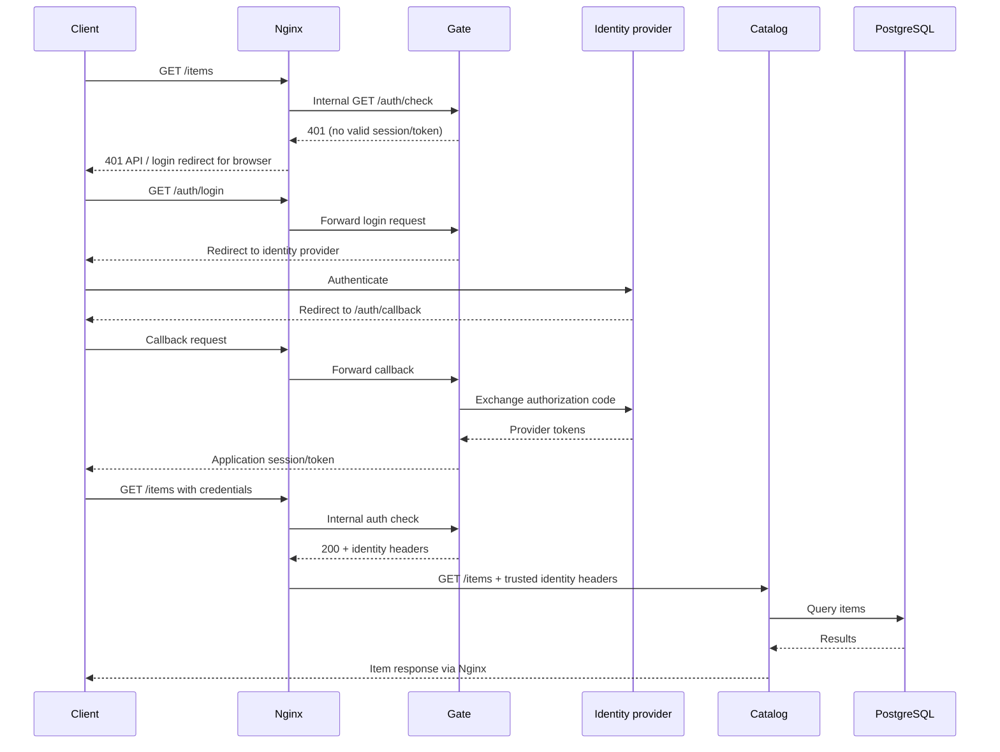

# Orbit — Backend Engineering Case Study

## Objective

Orbit explores a practical backend design question: **how can a business service stay focused on business logic while authentication is handled at a separate boundary?** The system combines a dedicated authentication service (Gate), an item API (Catalog), Nginx forward authentication, and PostgreSQL persistence. It is an educational portfolio project designed to demonstrate implementation and architectural reasoning, not a production SaaS product.

## Component responsibilities

**Gate — identity and session boundary.** Gate implements login, callback and authentication-check endpoints. It exchanges credentials with a configured OAuth/OIDC provider, normalizes configured group claims, issues its own signed token, and validates incoming sessions or bearer tokens for Nginx's internal authorization check. Its routes and token helpers are in [`apps/gate/gate/auth/`](apps/gate/gate/auth/).

**Catalog — business API.** Catalog exposes item listing, lookup and creation routes. It uses SQLAlchemy sessions and a repository layer backed by PostgreSQL. It deliberately contains no independent authentication implementation: this is an explicit trust-boundary choice, not a claim that arbitrary callers can safely reach Catalog. See [item routes](apps/catalog/catalog/server/items/router.py) and [repository](apps/catalog/catalog/db/repository.py).

**Nginx — enforcement point.** Nginx exposes port 8080 locally, routes `/auth/` to Gate, and uses `auth_request` for protected routes. Its `/auth/check` endpoint is marked `internal`, so external clients cannot invoke it directly through Nginx. On a successful check, it forwards identity headers to Catalog. See [configuration](deploy/nginx/orbit.conf).

**PostgreSQL and migrations.** A dedicated Compose migration service runs `alembic upgrade head` before Catalog is allowed to start. This makes schema preparation an explicit deployment dependency. The application still requires careful database compatibility and migration discipline in more complex releases.

## Request and login flow

The local stack uses a placeholder identity provider by default. The successful login path above describes the **configured-provider** mode, not something a fresh clone can demonstrate without credentials.

## Design decisions

### 1. Centralize authentication rather than duplicate it

Gate and Nginx own authentication concerns, while Catalog owns item operations. This keeps the business service small and makes authentication behavior easier to test independently. **Trade-off:** the proxy and network topology become security-critical. If Catalog were exposed directly, clients could bypass Gate. Identity headers must be stripped/overwritten at the trusted proxy, not accepted from arbitrary upstream clients.

### 2. Exchange provider identity for an application token

Gate is responsible for translating identity-provider information into the application's session/token representation. Group normalization is concentrated in one module instead of scattered across downstream endpoints. **Trade-off:** token signing-key protection, expiry, revocation strategy and claim validation all become part of Gate's responsibility. The project should not be interpreted as a complete enterprise identity platform.

### 3. Keep database access behind a repository layer

Catalog separates HTTP routing from persistence operations. SQLAlchemy handles database access, and Alembic manages schema evolution. **Trade-off:** even a small CRUD API gains extra abstractions; this is intentional to practice maintainability and testing.

### 4. Make startup dependencies explicit

Compose waits for PostgreSQL readiness and successful schema migration before starting Catalog; Nginx waits for service health checks. **Trade-off:** health checks and startup sequencing reduce common local failures but are not a substitute for production orchestration, retries, observability or disaster recovery.

### 5. Keep local development inexpensive

Docker Compose is the default runnable environment. Helm and EKS configuration are included to explore Kubernetes deployment, ingress, service identities and external secrets without requiring a continuously running cloud cluster. **Trade-off:** local Compose and EKS are different environments; parity needs verification rather than assumption.

## Testing and delivery

Gate tests cover authentication behavior such as login, callback, checks, tokens and group handling. Catalog tests cover API routes, client behavior and database interactions. Additional tests exercise Helm configuration and migration failure cases. The repository includes separate GitHub Actions workflows for the two services, and separate Dockerfiles/Poetry dependency sets. See [workflows](.github/workflows/) and [tests](apps/).

These files demonstrate the project's testing and delivery structure; they are not evidence of any particular CI pass rate, production uptime or performance benchmark.

## Infrastructure layers

| Local | Kubernetes / AWS-oriented |
| --- | --- |
| Docker Compose private network | Helm deployments and services |
| Nginx reverse proxy + forward auth | Nginx configuration behind Kubernetes ingress |
| PostgreSQL container | External database configuration |
| Environment-file configuration | External secret references and service identities |
| Container health checks and migration job | Kubernetes probes and deployment templates |

See [Compose](docker-compose.yml), [Helm chart](deploy/helm/orbit/) and [EKS configuration](deploy/eks/cluster.yaml). Cloud deployment requires replacing placeholders, provisioning dependencies and validating permissions.

## Limitations and next steps

- **Trust boundary:** keep Catalog inaccessible except through the enforcement proxy; add defense-in-depth if deployed in a less controlled network.
- **Authorization:** the current forward-auth check is not a complete route-and-method-specific authorization policy engine.
- **Token lifecycle:** explore revocation and key rotation, potentially using Redis or another shared state mechanism.
- **Resilience and observability:** expand structured tracing, failure injection, service-level metrics and recovery testing.
- **Performance:** add realistic load tests and document measured behavior before making scalability claims.
- **Deployment reproducibility:** validate the sanitized public configuration in each target environment, not only with local Compose.

## Where to start reviewing

For backend design, begin with [Gate authentication](apps/gate/gate/auth/router.py), [Nginx authorization routing](deploy/nginx/orbit.conf), [Catalog item routes](apps/catalog/catalog/server/items/router.py) and [Catalog persistence](apps/catalog/catalog/db/repository.py). For delivery practices, explore [Compose](docker-compose.yml), [Helm](deploy/helm/orbit/) and [CI workflows](.github/workflows/).

[← Back to README](README.md)
