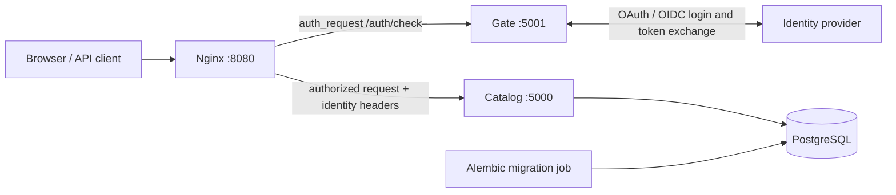

# Orbit

**A two-service Python backend exploring authentication boundaries, persistence, and cloud-native delivery.**

Two services sit behind nginx:

- **`gate`** — an authentication service. It is not in the request path. nginx
  holds each incoming request and asks `gate` whether the caller is allowed
  through, then forwards the original request with identity headers attached.
- **`catalog`** — an ordinary business service, deliberately trivial. It serves a
  list of items and contains no security code at all.

> **Portfolio project, not a hosted production service.** You can run the local stack without cloud credentials. Real interactive login requires configuring your own identity provider.

## Architecture



**Request flow:** Nginx exposes the only host-facing application port. For protected routes, it performs an internal subrequest to Gate. If authorized, Nginx forwards the original request to Catalog with identity headers; otherwise it returns `401` to API callers or redirects browser requests toward login. Catalog remains private on the Compose network. Public health/info routes are explicitly exempted.

## What this project demonstrates

| Area | Implementation |
| --- | --- |
| Backend APIs | FastAPI services with distinct authentication and business responsibilities |
| Authentication | OAuth/OIDC provider integration, Gate-issued signed tokens, Nginx `auth_request` |
| Data persistence | PostgreSQL, SQLAlchemy repository layer, Alembic migrations |
| Service boundaries | Catalog does not validate tokens; access control is enforced at the proxy/network boundary |
| Local infrastructure | Docker Compose with private service networking, health checks, and migration-before-start dependency |
| Testing | Gate authentication tests, Catalog API/database tests, Helm configuration and migration-failure tests |
| Delivery | Separate service Dockerfiles, GitHub Actions CI/release workflows, Helm chart and EKS configuration |

## Run locally

**Requirements:** Docker with Compose. To run Python tests locally, also install Python/Poetry and use the project's Makefile.

```bash
COMMIT=$(git rev-parse --short HEAD) docker compose up -d --build
```

Try the endpoints:

```bash
curl -i http://localhost:8080/items
curl -i http://localhost:8080/health/ready
curl -i http://localhost:5000/items
```

Expected results: `/items` returns **401** without credentials; `/health/ready` is public and should return **200** when healthy; direct access to Catalog on host port 5000 should fail because that port is not published. The stack starts with a placeholder identity provider, so an interactive login will not work until configured.

Stop the stack:

```bash
docker compose down
```

To configure a real provider, copy `apps/gate/.env.example` to `apps/gate/.env` and supply your own provider URL, client ID, client secret and claim settings. **Never commit `.env` or real credentials.** See [Gate settings](apps/gate/gate/config.py).

## Tests

The repository includes separate test suites for Gate and Catalog. Catalog database tests require a disposable PostgreSQL instance and use an `orbit_test` database. The existing [test setup instructions](#test-setup) below use a local Docker database; never point these fixtures at valuable data.

### Test setup

```bash
docker run -d --name orbit-test-postgres -e POSTGRES_PASSWORD=orbit-dev -p 127.0.0.1:55432:5432 postgres:18
```

Once `docker exec orbit-test-postgres pg_isready -U postgres` reports readiness:

```bash
make install
DB_HOST=127.0.0.1 DB_PORT=55432 make test
```

Cleanup:

```bash
docker rm -f orbit-test-postgres
```

Gate tests mock the identity provider. Helm-focused tests live under `deploy/helm/tests`.

## Explore the code

- [Gate authentication routes](apps/gate/gate/auth/router.py) and [token utilities](apps/gate/gate/auth/utils.py)
- [Catalog item API](apps/catalog/catalog/server/items/router.py), [repository](apps/catalog/catalog/db/repository.py) and [database layer](apps/catalog/catalog/db/database.py)
- [Nginx forward-auth configuration](deploy/nginx/orbit.conf)
- [Docker Compose stack](docker-compose.yml) and [Alembic migration](apps/catalog/alembic/versions/29e2adff3aba_create_items_table.py)
- [Helm templates](deploy/helm/orbit/templates/) and [GitHub Actions workflows](.github/workflows/)
- [Token flow illustration](docs/token-flow.html)

## Engineering decisions and trade-offs

For the reasoning behind the service split, the trust boundary, token design, migration ordering and deployment approach, read the **[engineering case study](PORTFOLIO.md)**.

## Scope

Orbit is a learning and portfolio system, not a claim of production hardening or measured high-scale performance. In particular, its security model assumes Catalog cannot be reached except through the trusted proxy, and deployment-specific secrets must be supplied externally. See the case study for limitations and potential improvements.
